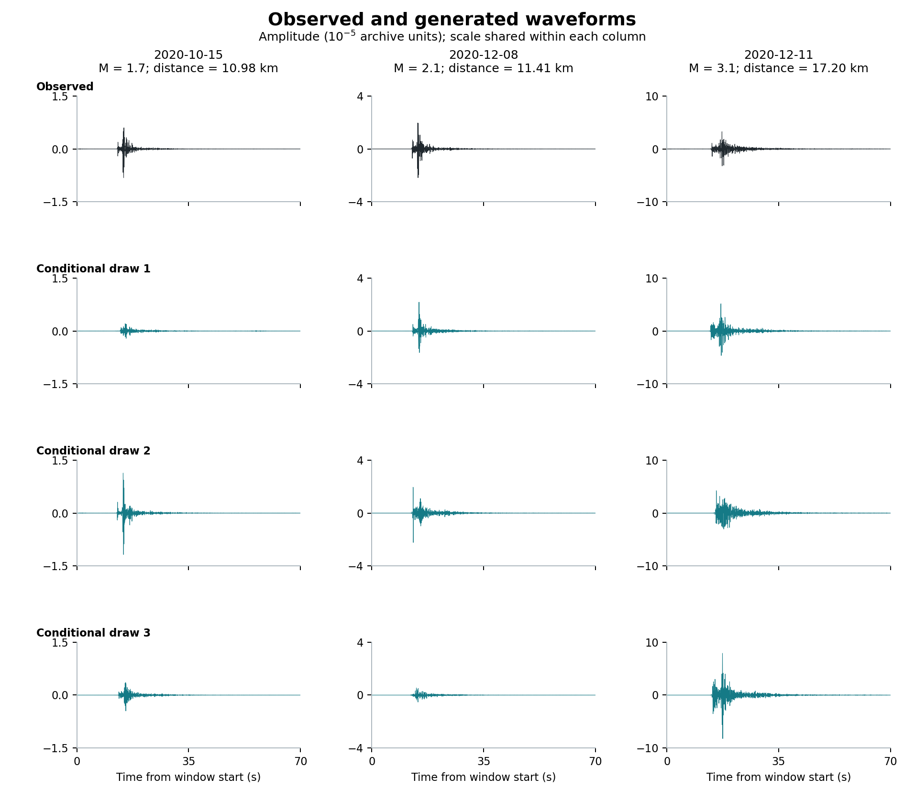

# Seismic waveform diffusion at ARMT

## Working paper — October 2026

[Read the paper (PDF)](output/pdf/working_paper.pdf) · [LaTeX source](research/manuscript/working_paper.tex) · [Paper files and reproduction notes](research/manuscript/README.md)

The paper studies conditional-reference diffusion on 1,183 vertical recordings from station ARMT, with 774 training and 169 validation recordings. Across three runs, the conditional reference reduces feature CRPS by 6.39% relative to a global reference. Empirical retrieval has a better feature score, while conditional diffusion has better complementary waveform scores. Validation informed model selection, so the results are exploratory.

The PDF includes observed and generated waveform examples on page 7 and a comparison across generation methods on page 14. It contains 15 pages, four figures and six tables.



## Legacy Stage 1 implementation

The code and commands below describe the earlier Stage 1 pipeline. They do not reproduce the conditional-reference experiments reported in the working paper.

Conditional diffusion model that synthesizes Z‑component seismograms at station `ARMT` from event metadata. This repo contains preprocessing scripts, training and evaluation code, and a Streamlit UI. Source data, prebuilt artifacts and model checkpoints are not included.

### What’s inside
- Required private data: `processed_events.csv`, `timeseries_Z.csv` (not included)
- Optional private artifacts: `artifacts/v2/` (aligned + global norm) and `artifacts/v3_trimmed/` (10 s trimmed, refreshed stats), supplied separately
- Code: `prepare_stage1_v2.py`, `trim_stage1_artifacts.py`, `dataset_stage1.py`, `model_stage1.py`, `train_stage1.py`, `evaluate_stage1.py`, `ui_stage1.py`
- Configs & docs: `configs/*.yaml`, `configs/README.md`, `docs/STAGE1_README.md`, `README_TRANSFER.md`

### Setup
1) Python 3.10–3.12 recommended.  
2) Install deps:
```
pip install --upgrade pip
pip install -r requirements.txt
```
3) Install PyTorch for your hardware (examples):  
   - CPU: `pip install torch --index-url https://download.pytorch.org/whl/cpu`  
   - CUDA: use the command from the PyTorch selector for your CUDA version.

### Quickstart
- **Use existing artifacts** after supplying them in `artifacts/v2` and `artifacts/v3_trimmed`. To regenerate:
```
python prepare_stage1_v2.py --data-root . --out-root artifacts/v2
python trim_stage1_artifacts.py --source-dir artifacts/v2 --output-dir artifacts/v3_trimmed --force-cut-samples 1000
```
- **Train** (trimmed pipeline):
```
python train_stage1.py --config configs/stage1_v3.yaml --artifact-version v3_trimmed --data-root . --run-name stage1_v3
```
- **Evaluate**:
```
python evaluate_stage1.py --artifact-version v3_trimmed --checkpoint <path_to_checkpoint>
```
- **UI**:
```
streamlit run ui_stage1.py
```
- **Pack without models** (optional, bash):
```
./pack_without_models.sh
```

### Directory overview
- `artifacts/` — v2 aligned artifacts and v3 trimmed bundle
- `configs/` — YAML configs + notes
- `docs/` — Stage 1 engineering notes
- `*.py` — data prep, dataset, model, training, evaluation, UI
- `png/` — waveform previews

### Notes
- Private datasets, training artifacts and model checkpoints are not included.
- See `docs/STAGE1_README.md` for deeper engineering details.

